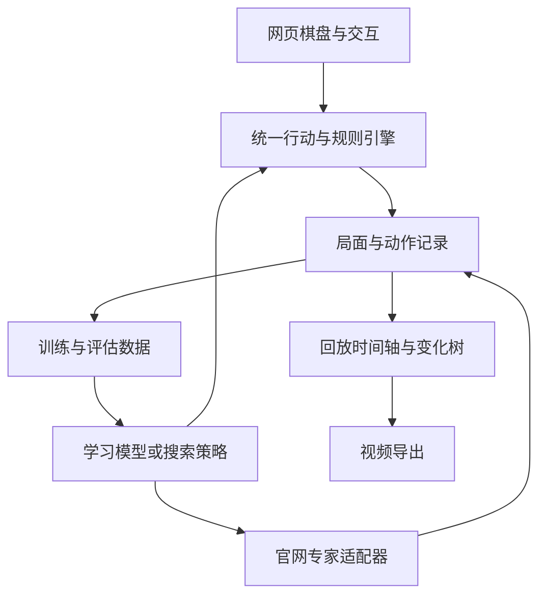

# 架构、状态与接口契约

## 当前代码与参考站点的边界

当前 Python 代码是独立实现。参考站点公开脚本用于核对规则和对外协议，未直接打包整个前端或服务端实现。

| 层 | 参考站点可确认结构 | 本仓库当前实现 |
|---|---|---|
| 游戏状态 | React Context / GameProvider | 不可变 Python State |
| 棋盘显示 | DOM + CSS Grid | React / 19-track CSS Grid |
| 悔棋 | 操作前状态与棋谱快照 | 网页按合法历史恢复前一局面 |
| 棋谱重放 | replayMoves 从开局重建 | 浏览器 replay 与 Python State.from_moves 严格验证 |
| 电脑应手 | Socket.IO /ai | RemoteExpert |
| 批量训练数据 | 未验证站点内部实现 | collect.py，JSONL + 检查点 |
| 强化学习接口 | 未知 | QuoridorEnv |
| HTTP | 第三方 API | FastAPI，仅本机监听 |
| 视频 | Canvas / MediaRecorder / WASM 与服务端路径 | Canvas / MediaRecorder，优先原生 MP4，回退 WebM |

## 推荐的完整复刻结构



网页视角、真实棋局、回放游标、分析变化必须分别建模。旋转不改变逻辑坐标；浏览历史不删除后续记录；试走不改写真实对局。

## 双人规则状态

本仓库 `State` 保存：

```text
pawns:     ((row,col),(row,col))，标准开局 ((8,4),(0,4))
walls:     完整墙锚点 (kind,row,col) 的元组，kind 为 h 或 v
remaining: (红剩余墙数,蓝剩余墙数)
turn:      1 或 2
winner:    null、1 或 2
history:   规范记谱序列
```

行 0 在上，列 0 是 a。完整墙锚点在 8×8 的交点域内。

原站状态还使用 `boardState[9][9]`、`horizontalWalls[8][9]` 和 `verticalWalls[9][8]`。本仓库将完整墙生成两条阻断边，以便直接区分一道墙的中心和两道墙相接的接缝。

### 行动验证

1. 检查类型、坐标范围和棋局是否结束。
2. 走棋验证普通移动、跳跃或受阻后的斜跳。
3. 放墙验证剩余墙、重叠和交叉。
4. 临时加入墙，对双方做 BFS，确认仍有目标通路。
5. 应用动作，生成新 State、记谱和胜负，不原地修改旧对象。

通路检查忽略暂时占据格子的棋子；实际走棋必须考虑对方棋子。两种寻路目的不能混用。

## 记谱与动作编号

规范输出：`e2` 为移动，`he4`、`ve6` 为墙。输入另兼容合法的后缀方向记谱，如 `e4h`。非法历史会在出错半回合处拒绝，不通过宽松解析伪造局面。

动作空间固定为 209：

- `0..80`：移动目标格，编号 `row*9+col`。
- `81..144`：横墙，编号 `81+row*8+col`。
- `145..208`：竖墙，编号 `145+row*8+col`。

例如 e2 是 `(7,4)`，编号 67。当前合法性另由 209 维动作掩码给出，模型不得在所有编号中无约束采样。

## 观察张量

`board` 为 float32 `[8,9,9]`：

1. 红棋位置。
2. 蓝棋位置。
3. 横向阻断边，填入前 8 行，其余补零。
4. 纵向阻断边，填入前 8 列，其余补零。
5. 红方剩余墙数 / 10，广播全平面。
6. 蓝方剩余墙数 / 10，广播全平面。
7. 当前玩家减一，广播全平面。
8. 已走步数 / 最大步数，截到 1。

当前使用绝对坐标，不随学习方翻转。`info.learner_player` 标记学习方；后续如改为执子方统一视角，必须同步改变动作编号映射和数据版本。

## 官网专家协议

公开前端使用：

```text
Base:      https://api.barricade.gg
Namespace: /ai
Event:     ai:get_move
Payload:   { moves: "e2,e8,...", difficulty: "expert",
             correlationId: <请求ID>, deviceId: <持续复用的客户端ID> }
Ack:       { ok: true, correlationId: <请求ID>, move: "..." }
```

适配器使用 Socket.IO polling 传输，保持连接。每个请求串行并验证应手合法性；可读缓存键包括服务地址、难度和完整棋谱。请求对应关系、服务错误和返回结构也会检查。

`data/device-id.txt` 在本地首次运行生成并持续复用；不是浏览器账号，也不是认证绕过方法。缓存命中标记 `cached=true`，不当作新的独立专家采样。限流和访问拒绝停止采集；没有自动轮换身份或替代走法。

## 本地 HTTP 契约

默认地址 `http://127.0.0.1:8765`，交互文档 `/docs`，OpenAPI `/openapi.json`。

| 方法 / 路径 | 输入 | 主要输出 |
|---|---|---|
| GET `/health` | 无 | 难度、空间维度、调用计数 |
| POST `/state` | `moves` | 严格重放后的 state、mask |
| POST `/expert/move` | `moves` | 动作 ID、记谱、来源、耗时、缓存和响应元数据 |
| POST `/games` | opponent、learner_player、max_plies、seed | game_id、state、观察与掩码 |
| GET `/games/{id}` | 无 | 当前状态与观察 |
| POST `/games/{id}/step` | action_id 或 notation，二选一 | 双方动作、奖励、terminated、truncated |
| POST `/games/{id}/reset` | 无 | 新开局；执蓝时含专家首步 |
| DELETE `/games/{id}` | 无 | 丢弃内存会话 |

本地非法输入通常返回 400；未知会话 404；明确上游限流 429；其他上游错误 502。上游失败可能发生在学习方动作已经应用之后，应检查当前状态再重置，不能重复提交同一动作。

HTTP 游戏会话只存在于内存，服务重启后清空。采集器保存训练记录，独立 `/records` 接口则保存 SQLite 棋谱档案。

## 数据记录

`transitions.jsonl` 每个动作一行，包含：

- schema_version、episode_id、ply、player、history。
- observation、action_mask、action_id、notation。
- is_teacher、source、latency_seconds、cached、metadata。
- after：落子后的完整可序列化局面。

`episodes.jsonl` 保存每盘配置、开始 / 结束时间、完整棋谱、终局、winner、finished_reason、status。采集到步数上限为 `truncated`，不能当作自然和棋或失败。

逐步样本在行动后立即追加，随后原子更新 pending 检查点。恢复时重建已提交前缀，并去掉该盘检查点之后的未提交尾行。采集策略的随机数状态也会恢复。

已发布样例去除了请求 / 会话标识；本地新采集数据保留原始响应以便检查。小样本用于复现实验链路，不作为已达到强度的证据。

## 网页棋谱保存格式

网页使用独立的规则版本、初始配置、主线、结果与单层变化集合：

```json
{
  "schema_version": 1,
  "rules_version": "classic-9x9-v1",
  "initial": {"pawns": ["e1", "e9"], "walls": [10, 10], "turn": 1},
  "moves": ["e2", "e8", "he4"],
  "result": {"winner": 1, "reason": "resign"},
  "variations": []
}
```

这是当前 JSON 导入导出、浏览器记录库和 `/records` 接口使用的格式。变化为 `{ "anchor": 0, "moves": ["f9", "e3"] }`；锚点为主线动作索引，-1 表示开局。`/games` 仍是训练会话。认输元数据独立保存，不从最后棋盘推断。

## 模块文件

- `training/quoridor_lab/rules.py`：规则、State、动作编号和观察。
- `opponents.py`：官网专家和本地策略。
- `collect.py`：串行采集、样本落盘与恢复。
- `env.py`：Gymnasium 单学习方环境。
- `api.py`：FastAPI 接口与内存会话。
- `cli.py`：probe、collect、serve 命令。
- `training/examples/`：训练示例。

网页已经接入这些规则与策略边界；联网请求、规则、回放游标和 UI 偏好应继续保持职责区分。


## 2026-11-10 网页模块

- `frontend/src/components/Board.jsx` 使用与来源相同的 19×19 网格，点击与拖放统一调用行动校验。
- `frontend/src/App.jsx` 区分真实对局、回放游标、变化和展示偏好。旋转保持绝对坐标。历史浏览与变化保留主线。
- `frontend/src/game/rules.js` 与 Python 对照全部行动、掩码、距离和观察。
- `frontend/src/game/record.js` 实现上文保存格式，兼容原站 `moves` 与 `var` URL。额外结果参数用于保留认输元数据。
- `frontend/src/game/agents.js` 提供注册、HTTP 与 Worker 接口。每局独立请求版本，取消 / 重开后丢弃过期应手，策略输入使用副本。
- `frontend/src/components/ClipDialog.jsx` 从统一棋谱生成预览和本地录制。

当前沿用原站本地刷新开新局，同时增加独立的自动记录库。变化首步允许后退到分叉点。模型未配置会返回明确不可用状态，网页保持当前局面供重试。离线包及最终验收见 [交付验收](DELIVERY_AUDIT.md)。

## 2026-11-12 界面调整与片段

棋盘继续使用 19×19 轨道表达格子与墙槽。桌面回放右栏与手机对战、回放分别使用响应式布局；合法目的地有动画提示，棋子移动使用过渡。`ClipDialog.jsx` 以 720×1280 Canvas 绘制片段，最多取前 100 个动作，使用浏览器 MediaRecorder；棋子与墙的音效资源由 `game/preferences.js` 解码并供对局及片段使用。实现不等于跨浏览器验收，具体结果见 [交付验收](DELIVERY_AUDIT.md)。

## 中英文界面与路障归属

`frontend/src/i18n.jsx` 用 React Context 提供当前语言、语言选择控件与翻译函数，沿用浏览器偏好存储。`translations.js` 保留中文文案键及英文词典，支持插值和延迟渲染提示，同时更新 HTML lang 与文档标题。棋谱和策略使用规则层的原始动作编号及记谱。`Board.jsx` 根据行动历史中的玩家顺序确定墙的放置者，样式对红蓝双方分别设色。
